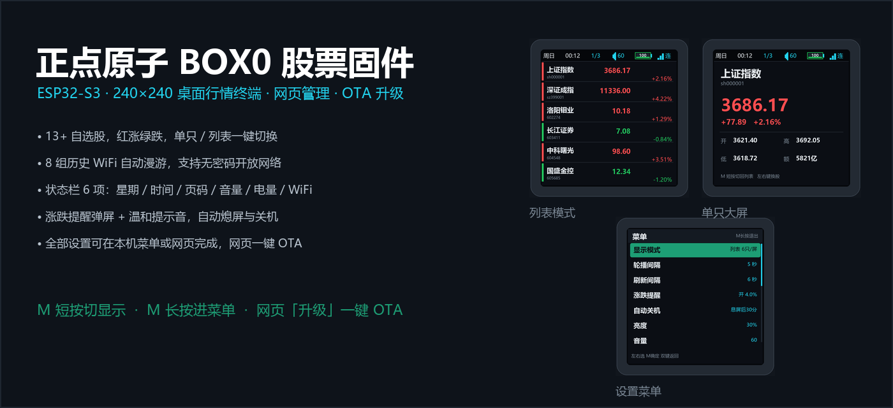
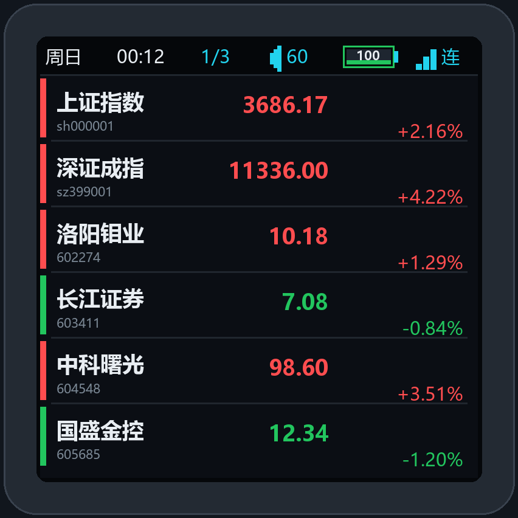
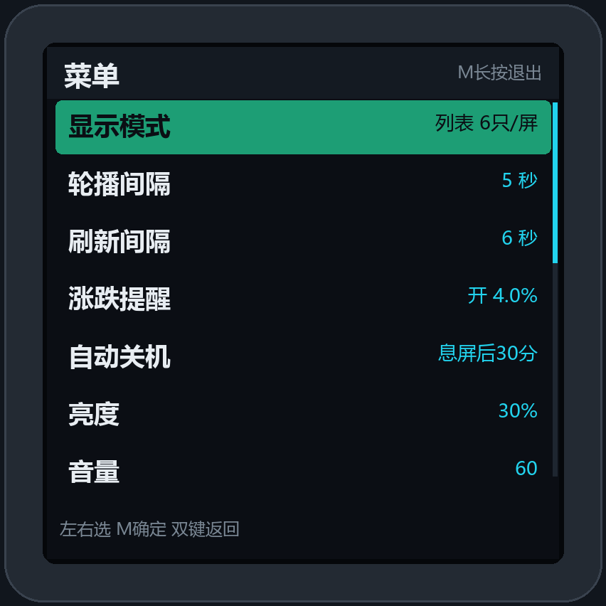
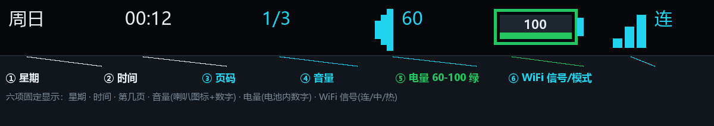
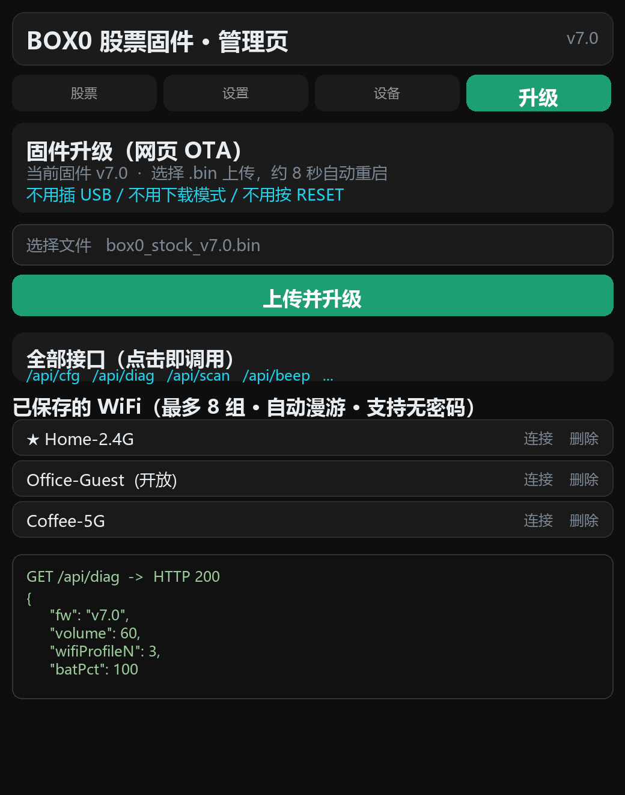

# 正点原子 BOX0 股票固件



把 **正点原子 ATK-DNESP32S3 BOX0**（ESP32-S3 / 240×240 圆角屏 / ES8311 内置喇叭 / 锂电池）改造成一台桌面股票行情终端：开机自动连 WiFi 拉取 A 股、指数、ETF 行情，红涨绿跌显示，支持单只大屏与一屏 6 只列表、涨跌幅度提醒弹屏与温和提示音、多组历史 WiFi 自动漫游；所有设置既能在盒子上用三键操作，也能在网页里改，**固件升级直接网页 OTA**，不需要插 USB、不需要进下载模式。

> 当前版本 **v7.0** · Arduino-ESP32 3.x · 本仓库附带源码与编译好的 `.bin` 固件。
> 行情数据来自新浪财经公开接口，可能延迟或中断，仅供个人参考，**不构成投资建议**。

## 功能一览

| 分类 | 功能 |
|---|---|
| 行情 | 最多 30 只自选股（A 股 / 指数 / ETF / 港股 / 美股），6 位纯数字代码自动补 `sh`/`sz`，交易时段按间隔刷新；红涨绿跌，显示现价、涨跌额、涨跌幅、开高低、成交额、同时段放量对比 |
| 显示 | 列表一屏 6 只（自动/手动翻页）、单只大屏（大字现价）、两种模式一键切换；状态栏固定 6 项；亮度 10–100% |
| 提醒 | 涨跌幅超过阈值时强制切单只弹屏 + 字符跳动 + 边框闪烁 + 温和提示音；按「天 + 股票 + 阈值」去重，不会重复轰炸 |
| 音频 | ES8311 codec + 板载功放，700Hz 正弦提示音带渐入渐出包络；音量 0–100，出厂默认 60；网页可一键测试 |
| 网络 | 常开配置热点 `BOX0-Setup` + STA 双模；**最多 8 组历史 WiFi 凭据**，换地点按信号自动选网，支持无密码开放网络 |
| 电源 | 自动熄屏 0/1/3/5/10/30/60/120 分钟；自动关机（关闭 / 息屏后 30 分 / 1 时 / 2 时 / 4 时）；电池百分比与充电状态显示 |
| 配置 | 设备 12 项菜单 + 网页 4 个标签页，改动即时保存；管理密码可改 |
| 维护 | 网页 OTA 升级、诊断 JSON、扫描 WiFi、刷新行情、重新联网、恢复出厂、关机，全部有网页入口 |

## 界面

| 列表模式（6 只/屏） | 单只大屏 | 设置菜单 |
|:---:|:---:|:---:|
|  |  |  |



顶部信息栏固定显示 **6 项**（v7.0）：

| # | 内容 | 说明 |
|---|---|---|
| ① | 星期 | `周日`…`周六`，由 NTP 对时得到 |
| ② | 时间 | `HH:MM`，东八区 |
| ③ | 第几页 | 列表为 `当前页/总页数`；单只模式为 `第几只/总数` |
| ④ | 音量 | **喇叭图标 + 数字**，音量为 0 时图标变灰 |
| ⑤ | 电量 | **百分比数字画在电池图标内部**；60–100 绿色、20–59 橙色、<20 红色；正极青色表示充电中 |
| ⑥ | WiFi 信号（模式） | 缩小的 3 格信号 + `连`（已连路由）/ `中`（连接中）/ `热`（热点模式） |

> `docs/*.png` 是用 [`tools/render_screens.py`](tools/render_screens.py) 按固件真实坐标渲染的**界面示意图**（非实拍照片），行情数字为示例数据。运行 `python tools/render_screens.py` 可重新生成。



## 三键操作

### 主界面

| 按键 | 行为 |
|---|---|
| 左 / 右 **短按** | 上一页 / 下一页（列表）；上一只 / 下一只（单只） |
| 左 / 右 **长按 + 一直按住** | 音量 −5 / +5，每 170ms 连发，屏幕显示音量条 |
| **M 短按** | **单只大屏 ↔ 列表 切换** |
| **M 双击** | 立即刷新行情 |
| **M 长按** | **进入设置菜单** |
| 左右 **同按短按** | 进入设置菜单（M 键兜底） |
| 左右 **同按 1.5 秒** | 关机 |
| M + 右 **同按 3 秒** | 强制进入 USB 下载模式（刷机用） |
| 熄屏后任意键 | 点亮屏幕（这一下不触发功能） |

### 菜单 / 调节 / 确认 / 信息页

| 按键 | 行为 |
|---|---|
| 左 / 右 | 移动选项 / 减值·加值（长按连发） |
| M 短按 | 确定 / 完成并返回菜单（提醒页为切换开关） |
| 左右同按短按 | **返回上一级** |
| **M 长按** | **任何页面直接回主界面** |
| 无操作 8 秒 | 自动返回主界面（兜底，不必再依赖它） |

菜单 12 项：显示模式、轮播间隔、刷新间隔、涨跌提醒（开关+阈值）、自动关机、亮度、音量、自动熄屏、测试提示音、设备信息、恢复出厂、关机。

## 网页管理

- 连上同一路由器后访问 `http://<设备IP>/`（也可 `http://box0.local/`）；未配网时连热点 `BOX0-Setup` 访问 `http://192.168.4.1/`。
- **默认管理密码 `123456`，首次使用请到「设置 → 安全」修改。**
- 四个标签页：**股票**（自选股、快速添加）、**设置**（显示/亮度/音量/行情/提醒/熄屏/关机/密码）、**设备**（WiFi 扫描与配网、已保存 WiFi、诊断、刷新、重连、测试音、关机、恢复出厂）、**升级**（网页 OTA + 全部接口面板）。

### HTTP 接口

| 方法 | 路径 | 用途 |
|---|---|---|
| GET | `/api/cfg` | 全部配置 + 网络状态 + 历史 WiFi 列表（**不返回密码**） |
| GET | `/api/diag` | 设备诊断（固件版本、codec、按键边沿、电量、I2C、行情数等） |
| GET | `/api/wifi` | 网络状态；带 `ssid`/`pass` 参数可地址栏救急配网 |
| GET | `/api/scan` `/api/scanres` | 触发 WiFi 扫描 / 读取扫描结果 |
| POST | `/api/stocks` | 保存自选股 |
| POST | `/api/settings` | 保存显示、亮度、音量、提醒、熄屏、关机、管理密码等 |
| POST | `/api/wifi` | 配网并记住该组凭据（密码留空 = 开放网络） |
| POST | `/api/wifisel` `/api/wifidel` | 切换到 / 删除某条历史 WiFi |
| POST | `/api/beep` `/api/refresh` `/api/reconnect` | 测试提示音 / 立即刷新行情 / 重新联网 |
| POST | `/api/power` `/api/reset` | 关机 / 恢复出厂 |
| GET | `/ota` | 独立升级页 |
| POST | `/api/ota` | 上传 `.bin` 应用镜像，写完自动重启 |

除 `/login` 外，所有接口都需要登录 Cookie（或用 `?pw=管理密码`）。网页「升级」页里内置了一键调用常用只读接口并展示原始返回的面板。

## 多组 WiFi 与自动漫游

- 每次配网都会把 `SSID + 密码` 存入 NVS，**最多 8 组**，按 SSID 去重、最近使用排最前；旧版单组配置会自动迁移为第 1 组。
- 开机时若存了多组，先扫描周边并选**信号最好的已保存网络**；连接失败会在 6 秒内立刻改试其它已存网络（不再干等 2 分钟）；掉线时重新扫描选网；信号弱于 −75dBm 时每 3 分钟检查是否有更优网络。
- **无密码开放网络**：网页密码框留空即可，扫描结果会标注「开放(无密码)」，设备走 `WiFi.begin(ssid)` 单参数连接。
- 网页「设备 → 已保存的 WiFi」可查看列表（只显示名称，不回传密码）、一键切换或删除。
- 密码明文存放在设备 NVS（本机可读），**不会**出现在 HTTP 响应、固件镜像或本仓库中。

## 编译与烧录

### 环境

Arduino-ESP32 3.x（esp32s3）、LovyanGFX、ESPAsyncWebServer、AsyncTCP、ArduinoJson 7、ESP32-audioI2S。字库 `font_cn.h` 已随仓库提供。

```bash
arduino-cli compile \
  --fqbn "esp32:esp32:esp32s3:FlashSize=16M,PSRAM=opi,PartitionScheme=app3M_fat9M_16MB,CDCOnBoot=cdc,USBMode=hwcdc,CPUFreq=240" \
  --build-path build .
```

分区方案必须带两个 3MB app 分区（`app0 0x10000` / `app1 0x310000`），否则网页 OTA 不可用。编译产物约 1.7MB。

### 方式一：网页 OTA（推荐，日常升级）

打开 `http://<设备IP>/` → **升级** 标签页 → 选择 `.bin` → 「上传并升级」。约 8 秒写完并自动重启，**不用插 USB、不用下载模式、不用按 RESET**，NVS 里的 WiFi、自选股、音量等配置全部保留。也可用 `firmware/` 里现成的镜像。

命令行等价写法：

```bash
curl -F "f=@box0_stock_v7.0.bin" "http://<设备IP>/api/ota?pw=123456"
```

### 方式二：USB 首次烧录

按住**右键** + 点一下 RESET 进入下载模式（设备管理器出现 COM 口，USB PID `4003`），然后：

```bash
esptool.py --chip esp32s3 -p COM8 -b 460800 \
  write_flash --flash-mode dio --flash-freq 80m --flash-size 16MB \
  0x10000 firmware/box0_stock_v7.0.bin
```

或 Windows 下运行 `flash_app.bat COM8`（只写应用区，不丢配置）。

> ⚠ **这块板子的硬件特性**：USB 烧录完成后，esptool 的 RTS/DTR 硬复位**不会**让固件启动，必须**手动点一下 RESET**（不按任何键）。正常运行时设备不暴露 COM 口。网页 OTA 无此问题。
> 若 OTA 中途被打断导致启动异常，先 `esptool.py erase_region 0xe000 0x2000` 清 otadata 再重烧。

## 默认配置

| 项 | 默认值 |
|---|---|
| 音量 / 亮度 | 60 / 30% |
| 行情刷新 / 轮播 | 6 秒 / 5 秒 |
| 涨跌提醒 | 开，阈值 4% |
| 自动熄屏 | 不自动熄屏 |
| 自动关机 | 息屏后 30 分钟 |
| 显示模式 | 列表（6 只/屏） |
| 自选股 | 13 只（含上证、深成指与常用 ETF），可在网页里改 |
| 管理密码 | `123456`（**请尽快修改**） |

## 硬件与引脚

以小智开源项目 `main/boards/alientek/atk-dnesp32s3-box0/config.h` 为准：

| 部件 | 配置 |
|---|---|
| 主控 | ESP32-S3，16MB Flash，OPI PSRAM，240MHz |
| 屏幕 | ST7789 240×240，SPI，LovyanGFX 驱动 |
| 按键 | 左 GPIO3 / **中 M GPIO4（高电平有效）** / 右 GPIO0（左右为低电平有效） |
| 音频 | ES8311 @ I2C `0x18`，I2S 16kHz，功放使能 GPIO21，codec 供电 GPIO14 |
| 电源 | 电池 ADC GPIO1，充电状态 GPIO48，电源锁存 GPIO2 |
| I2C | SDA GPIO11 / SCL GPIO12 |

两个已验证的坑：① ES8311 的 `0x32` 音量寄存器上电为 0（静音），必须显式写入；② 不要在对提示音路径里反复 `pinMode(CODEC_PWR, OUTPUT)`，那会让 codec 瞬间掉电并复位寄存器。

## 目录结构

```
├── box0_radio_stock.ino     主程序：场景状态机、按键、自动关机、提醒
├── app_config.*             配置与 NVS、历史 WiFi 凭据
├── web_admin.cpp            网页服务、全部 HTTP 接口、OTA
├── wifi_mgr.cpp             AP+STA 状态机、扫描选网、自动漫游
├── ui_display.cpp           屏幕绘制、状态栏、菜单、提醒弹屏
├── buttons.cpp              5ms 采样按键状态机（短/长/连发/双击/组合）
├── stock_feed.cpp           行情抓取与解析
├── beep.cpp / radio_player.* ES8311 与 I2S 提示音
├── font_cn.h / font_render.* 中文点阵字库与渲染
├── firmware/                编译好的 .bin 固件
├── docs/                    界面渲染图
└── tools/render_screens.py  截图生成脚本
```

## 已知限制

- **板上没有 IMU/六轴传感器**（官方 config.h 无定义），「重力自动切换」选项不可用，请用单只或列表模式。
- 新闻条与在线电台已停用：前者在 ESP32 上解析大 JSON 内存不足，后者在当前网络播不出声；代码保留，`ENABLE_RADIO` 改 1 可恢复电台。
- 只支持 2.4GHz WiFi；5GHz SSID 连不上。
- 同时段放量对比依赖新浪 5 分钟分时线与 NTP 对时，数据缺失时不显示数值。
- 电池百分比基于官方 ADC 标定表，是估算值，不是电量计读数。
- 提示音触发瞬间部分 Windows 电脑会响一次「设备连接」提示音（电源瞬态），根治办法是用 5V 充电头供电，或在系统声音方案里关闭「设备连接/断开连接」事件音。

## 版本历史

| 版本 | 主要变化 |
|---|---|
| v7.0 | 8 组 WiFi 凭据自动漫游（含无密码）、状态栏 6 项重做、三键操作重设计与显式返回、网页「升级」tab + 全部接口面板、默认音量 60、网页 OTA 实测通过、移除固件内预置的个人 WiFi 凭据 |
| v6.2 | 盒子 12 项设置菜单、自动关机 4 档、音量状态栏显示、提示音温和化（700Hz 正弦 + 包络） |
| v6.1 | 修 ES8311 音量寄存器与 codec 电源毛刺（本机喇叭出声）、M 键高电平有效、电池官方标定 |
| v6.0 | 移除新闻、列表 6 只、单只大字体、亮度 30%、网页设置生效 |
| v5.x | 中文点阵修复、30 只自选股、同时段放量对比、涨跌提醒 |

## 许可

[MIT](LICENSE) · 欢迎提 Issue / PR。二次分发请保留版权声明。

> 本项目与正点原子、小智开源项目无官方关联；硬件引脚资料引自小智 `xiaozhi-esp32` 开源仓库。
