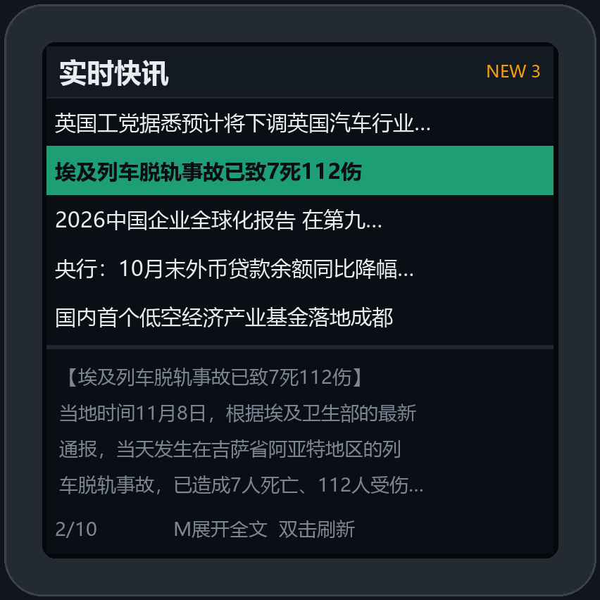
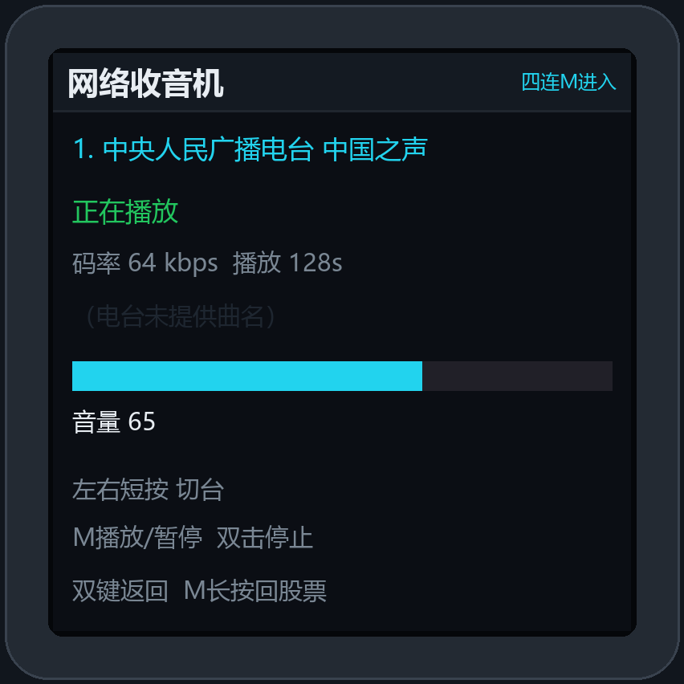
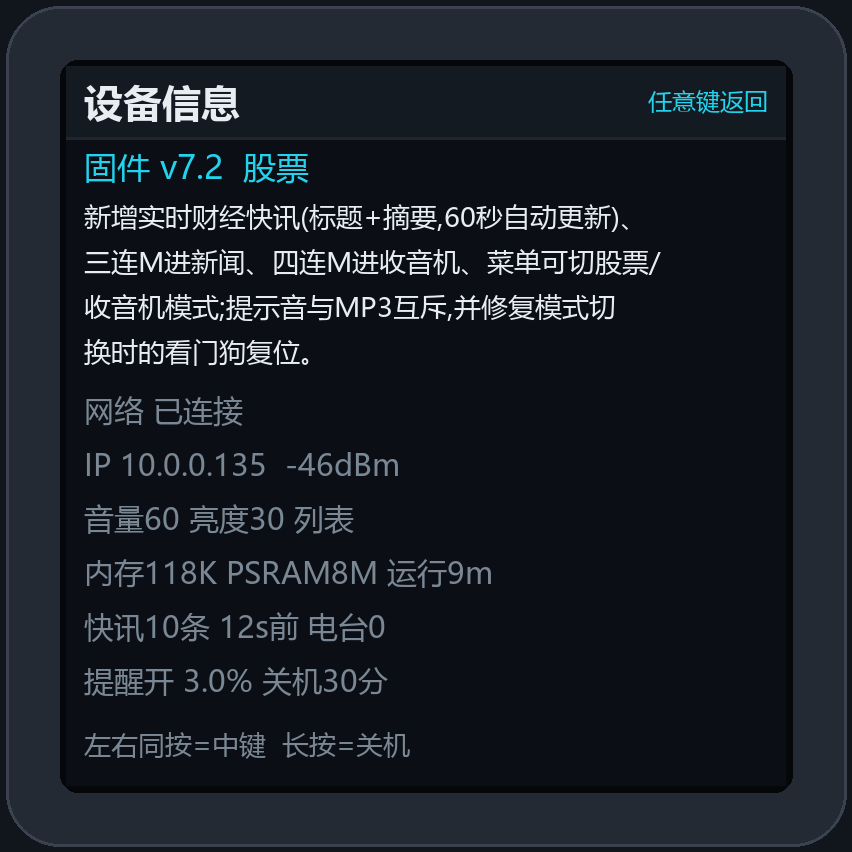

# 正点原子 BOX0 股票固件


把 **正点原子 ATK-DNESP32S3 BOX0**（ESP32-S3 / 240×240 圆角屏 / ES8311 内置喇叭 / 锂电池）改造成一台桌面股票行情终端：开机自动连 WiFi 拉取 A 股、指数、ETF 行情，红涨绿跌显示，支持单只大屏与一屏 6 只列表、涨跌幅度提醒弹屏与温和提示音、**两套可配置时间窗口（信息更新 / 预警提示）**、**全局与每只股票独立提醒阈值**、**实时财经快讯（标题 + 摘要）**、**网络收音机**、多组历史 WiFi 自动漫游；所有设置既能在盒子上用三键操作，也能在网页里改，**固件升级直接网页 OTA**，不需要插 USB、不需要进下载模式。

> 当前版本 **v7.2** · Arduino-ESP32 3.x · 本仓库附带源码、可用于网页 OTA 的应用镜像，以及**从任意官方固件刷过来都能启动的完整固件**。
> 行情数据来自新浪财经公开接口、快讯来自东方财富 7×24 公开接口，可能延迟或中断，仅供个人参考，**不构成投资建议**。
> 后续规划见 [ROADMAP.md](ROADMAP.md)（v7.3 分时线 / K 线本地绘制）。

## 功能一览

| 分类 | 功能 |
|---|---|
| 行情 | 最多 30 只自选股（A 股 / 指数 / ETF / 港股 / 美股），6 位纯数字代码自动补 `sh`/`sz`；**只在「信息更新」时段内按间隔刷新**（默认 9:00–11:30 / 13:00–15:00，可选时段外 5 分钟低频抓取）；红涨绿跌，显示现价、涨跌额、涨跌幅、开高低、成交额、同时段放量对比 |
| 显示 | 列表一屏 6 只（自动/手动翻页）、单只大屏（大字现价）、**定时自动切换**（每 30 秒在列表/单只间交替，间隔可设）；状态栏固定 6 项 + 新快讯红点；亮度 10–100% |
| 提醒 | **全局阈值 + 每只股票独立阈值**（留空跟随全局、`-1` 该股禁用），互不影响；只在「预警提示」时段内检查；总开关可关；触发时强制切单只弹屏 12 秒 + 字符跳动 + 边框闪烁 + 两声温和蜂鸣；按「天 + 股票 + 阈值变化」逐只去重，不会重复轰炸 |
| **实时快讯 v7.2** | 东方财富 7×24 财经快讯，**标题 + 一句话摘要**，默认 **60 秒自动更新**（30–3600 秒可调）；按 `code` 增量去重、最多缓存 20 条；三连 M 进新闻页，新消息只在状态栏亮红点，不响铃（可开）；`/api/news` 可读取缓存或立即抓取 |
| **网络收音机 v7.2** | 内置 8 个实测可播的中文电台（蜻蜓 / AsiaFM / 听云等，HTTP 明文 MP3）；**四连 M** 或菜单「工作模式」进入；左右切台、M 播放暂停、双击停止、长按音量；与提示音**分时独占 I2S**，不会抢声道 |
| 音频 | ES8311 codec + 板载功放，700Hz 正弦提示音带渐入渐出包络；音量 0–100，出厂默认 60；网页可一键测试 |
| 网络 | 常开配置热点 `BOX0-Setup` + STA 双模；**最多 8 组历史 WiFi 凭据**，换地点按信号自动选网，支持无密码开放网络 |
| 电源 | 自动熄屏 0/1/3/5/10/30/60/120 分钟；自动关机（关闭 / 息屏后 30 分 / 1 时 / 2 时 / 4 时）；v7.1 修复 M 键把深睡立刻唤醒导致「关不掉」；**v7.2 听广播时不自动关机**；电池百分比与充电状态显示 |
| 配置 | 设备 **14 项菜单** + 网页 4 个标签页，改动即时保存；管理密码可改；**设备信息页显示每个版本 1–100 字更新说明** |
| 维护 | 网页 OTA 升级、诊断 JSON、扫描 WiFi、刷新行情、重新联网、恢复出厂、关机、严格 I2C 姿态传感器探测，全部有网页入口 |

## 界面

| 列表模式（6 只/屏） | 单只大屏 | 设置菜单 |
|:---:|:---:|:---:|
|  |  |  |

| 实时快讯 v7.2 | 网络收音机 v7.2 | 设备信息 / 版本说明 |
|:---:|:---:|:---:|
|  |  |  |


顶部信息栏固定显示 **6 项**：

| # | 内容 | 说明 |
|---|---|---|
| ① | 星期 | `周日`…`周六`，由 NTP 对时得到 |
| ② | 时间 | `HH:MM`，东八区 |
| ③ | 第几页 | 列表为 `当前页/总页数`；单只模式为 `第几只/总数` |
| ④ | 音量 | **喇叭图标 + 数字**，音量为 0 时图标变灰 |
| ⑤ | 电量 | **百分比数字画在电池图标内部**；60–100 绿色、20–59 橙色、<20 红色；正极青色表示充电中 |
| ⑥ | WiFi 信号（模式） | 缩小的 3 格信号；**已连接路由时只显示图标、不显示文字**；`中`（连接中）/ `热`（热点模式）时才带一个汉字 |

> v7.2 追加：有新快讯时状态栏左侧出现一个小红点，进新闻页即清零。
> `docs/*.png` 是用 [`tools/render_screens.py`](tools/render_screens.py) 按固件真实坐标渲染的**界面示意图**（非实拍照片），行情数字为示例数据。运行 `python tools/render_screens.py` 可重新生成全部 9 张图。


## 三键操作

### 主界面

| 按键 | 行为 |
|---|---|
| 左 / 右 **短按** | 上一页 / 下一页（列表）；上一只 / 下一只（单只） |
| 左 / 右 **长按 + 一直按住** | 音量 −5 / +5，每 170ms 连发，屏幕显示音量条 |
| **M 短按** | **单只大屏 ↔ 列表 切换** |
| **M 双击** | 立即刷新行情（320ms 内的第二次按下即时响应） |
| **M 三连 v7.2** | **进入实时快讯页**（标题 + 摘要） |
| **M 四连 v7.2** | **进入网络收音机模式**（菜单「工作模式」也可切） |
| **M 长按** | **进入设置菜单** |
| 左右 **同按短按** | 进入设置菜单（M 键兜底） |
| 左右 **同按 1.5 秒** | 关机 |
| M + 右 **同按 3 秒** | 强制进入 USB 下载模式（刷机用） |
| 熄屏后任意键 | 点亮屏幕（这一下不触发功能） |

> 三连 / 四连在 320ms 窗口内累计点击；第 2 下按下时立即发「双击」，所以四连过程中会顺带刷新一次行情，属正常设计。

### 菜单 / 调节 / 确认 / 信息页

| 按键 | 行为 |
|---|---|
| 左 / 右 | 移动选项 / 减值·加值（长按连发） |
| M 短按 | 确定 / 完成并返回菜单（提醒页为切换开关） |
| 左右同按短按 | **返回上一级** |
| **M 长按** | **任何页面直接回主界面**；收音机子页面则直接退回股票模式并释放 I2S |
| 无操作 8 秒 | 自动返回主界面（兜底，不必再依赖它） |

菜单 **14 项**：显示模式、轮播间隔、刷新间隔、涨跌提醒、自动关机、亮度、音量、自动熄屏、测试提示音、设备信息、恢复出厂、关机、**工作模式（股票/收音机）**、**实时新闻**。

### 快讯页（v7.2）

| 按键 | 行为 |
|---|---|
| 左 / 右 短按 | 上一条 / 下一条 |
| M 短按 | 展开全文摘要 / 收起 |
| M 双击 | 立即抓取一次 |
| 左右同按短按 | 返回当前模式主页 |
| M 长按 | 回主界面 |

### 收音机页（v7.2）

| 按键 | 行为 |
|---|---|
| 左 / 右 短按 | 上一台 / 下一台 |
| 左 / 右 长按 | 音量 −5 / +5 |
| M 短按 | 播放 / 暂停 |
| M 双击 | 停止播放 |
| 左右同按短按 | **退回股票模式**（释放 MP3 解码器，提示音恢复） |
| M 长按 | 退回股票模式 |

## 实时快讯与网络收音机（v7.2）

### 实时快讯：只推「标题 + 一句话摘要」

早期版本曾在 ESP32 上用 `ArduinoJson` 解析新浪滚动新闻的大 JSON（40+ 字段 / 16KB），反复出现 filter 失效、内存不足、解析出 0 条的问题。v7.2 换成**东方财富 7×24 快讯**：HTTP 明文、UTF-8、无鉴权，单条约 600B，20 条约 11.6KB，字段干净。

- 不再用 JSON 库，改为**手写带边界的字符串扫描**（`findKey` / `copyVal`），处理 `\"`、`\\`、`\/`、`\n`、`\uXXXX` 并按 UTF-8 边界截断。
- 每条含 `title`、`summary`、`showTime`、唯一 `code`；按 `code` 增量去重，`g_newsNew` 只统计本次新增条数；首次启动不报 NEW，避免 20 条全变未读。
- 默认 **60 秒**轮询（可设 30–3600 秒）；`/api/news?kick=1` 可强制立即抓一次。
- 列表页 5 行标题 + 下方摘要预览；M 短按展开全文（中文自动换行）；摘要缺失时自动降级为纯标题。
- 新消息**默认只亮状态栏红点 + 一次 toast，不响铃**（深夜不吵）；网页可开「新消息提示音」，且仍受「预警提示」时段约束。
- 网页「设置 → 实时快讯」可改开关、刷新秒数、是否显示摘要、是否响铃，并可查看缓存列表。

### 网络收音机：与提示音分时独占 I2S

用户确认「提示音和 MP3 不会同时播放」，因此 `I2S_NUM_0` 可以**分时独占**，不需要混音：

| 模式 | I2S 归属 | 行为 |
|---|---|---|
| 股票（`APP_STOCK`，开机默认） | `beep` | 常驻 I2S 通道预热 MCLK，涨跌提醒蜂鸣正常 |
| 收音机（`APP_RADIO`） | `radio` | `beepReleaseI2S()` 删掉 beep 通道 → `radioEnsure()` 动态 `new Audio()` + `setPinout()` 接管 |
| 退回股票 | `beep` | `radioRelease()` 析构解码器释放通道 → `beepResumeI2S()` 重建 beep 通道 |

- 播放链路沿用**原厂 BOX0 固件**的 ES8311 上电序列与 I2S 引脚（`cfg_pins.h`），音量同时写 ES8311 `0x32` 与解码器。
- `Audio` 对象开机不创建，只有进收音机才分配；工作模式**不落盘**，开机一律回股票模式，避免半夜自动放广播。
- 网页（`async_tcp` 任务）只置 `g_pendingMode` 标志，真正的 I2S 交接与对象创建由主 `loop()` 执行。
- `audio.loop()` 会同步阻塞数秒，放在主循环会触发任务看门狗。v7.2 把它放进**独立解码任务**（优先级 1，循环 `vTaskDelay(2ms)`），并在 `setup()` 一次性把两个核的 IDLE 任务移出 TWDT。
  > 踩过的坑：早期版本「进收音机时 `disableCore*WDT()`、退出时 `enableCore*WDT()`」，重新挂载 IDLE 到 TWDT 后恢复不了喂狗，约 5 秒必然 `resetReason=6` 复位。最终改为**开机一次性关闭、全程不再开关**，四次「股票↔收音机」往返实测 `resetReason` 恒为 3、堆内存 77 KB ↔ 118 KB 正常回收。

### 版本更新说明

`app_config.h` 的 `FW_NOTES`（当前版本，1–100 字）与 `FW_HISTORY`（v7.2 / v7.1 / v7.0）会同时显示在**设备信息页**和网页「设备」标签页，也会进入 `/api/cfg`、`/api/diag`。每个版本发布时更新一段即可。当前 v7.2 说明：

> 新增实时财经快讯(标题+摘要,60秒自动更新)、三连M进新闻、四连M进收音机、菜单可切股票/收音机模式;提示音与MP3互斥,并修复模式切换时的看门狗复位。

## 网页管理

- 连上同一路由器后访问 `http://<设备IP>/`（也可 `http://box0.local/`）；未配网时连热点 `BOX0-Setup` 访问 `http://192.168.4.1/`。
- **默认管理密码 `123456`，首次使用请到「设置 → 安全」修改。**
- 四个标签页：**股票**（自选股、快速添加）、**设置**（显示/亮度/音量/行情/提醒/熄屏/关机/密码、两套时间窗口、每只股票独立阈值、**工作模式**、**实时快讯**）、**设备**（WiFi 扫描与配网、已保存 WiFi、诊断、刷新、重连、测试音、严格 I2C 探测、关机、恢复出厂、**版本更新说明**）、**升级**（网页 OTA + 全部接口面板）。
- v7.2 新增「工作模式」卡片（一键切股票/收音机 + 电台控制）与「实时快讯」卡片（开关/秒数/摘要/提示音 + 立即抓取 + 查看列表）。

### HTTP 接口

| 方法 | 路径 | 用途 |
|---|---|---|
| GET | `/api/cfg` | 全部配置 + 网络状态 + 历史 WiFi 列表（**不返回密码**）；v7.2 增 `appmode` / `newson` / `nsref` / `nssum` / `nsbeep` / `fwNotes` / `fwHistory` / 快讯与电台摘要 |
| GET | `/api/diag` | 设备诊断（固件版本、codec、按键边沿、电量、I2C、行情数、两套窗口是否命中、有效阈值、自动关机倒计时；v7.2 增 `appMode` / `resetReason` / `radioStage` / `i2sOwner` / `radioActive` / `radioBitrate` / 快讯诊断） |
| GET | `/api/wifi` | 网络状态；带 `ssid`/`pass` 参数可地址栏救急配网 |
| GET | `/api/scan` `/api/scanres` | 触发 WiFi 扫描 / 读取扫描结果 |
| GET | `/api/imu` | 触发严格 I2C 全总线探测（立即返回 `started`）；`?get=1` 读取结果，`?pwr=GPIO` 可临时给空闲脚供电再扫 |
| **GET** | **`/api/news`** | **读取快讯缓存（`t`/`s`/`c`/`time` 字段）；`?kick=1` 立即抓一次** |
| POST | `/api/stocks` | 保存自选股 |
| POST | `/api/settings` | 保存显示、亮度、音量、提醒、熄屏、关机、管理密码、快讯开关等 |
| POST | `/api/wifi` | 配网并记住该组凭据（密码留空 = 开放网络） |
| POST | `/api/wifisel` `/api/wifidel` | 切换到 / 删除某条历史 WiFi |
| **POST** | **`/api/mode`** | **`{"mode":0}` 股票 / `{"mode":1}` 收音机；异步只置标志，主 loop 执行切换** |
| **POST** | **`/api/radio`** | **`cmd=prev/next/toggle/stop/vol/mode` 电台控制** |
| POST | `/api/beep` `/api/refresh` `/api/reconnect` | 测试提示音 / 立即刷新行情 / 重新联网 |
| POST | `/api/power` `/api/reset` | 关机 / 恢复出厂 |
| GET | `/ota` | 独立升级页 |
| POST | `/api/ota` | 上传 `.bin` 应用镜像，写完自动重启 |

除 `/login` 外，所有接口都需要登录 Cookie（或用 `?pw=管理密码`）。网页「升级」页里内置了一键调用常用只读接口并展示原始返回的面板。

## 多组 WiFi 与自动漫游

- 每次配网都会把 `SSID + 密码` 存入 NVS，**最多 8 组**，按 SSID 去重、最近使用排最前；旧版单组配置会自动迁移为第 1 组。
- 开机时若存了多组，先扫描周边并选**信号最好的已保存网络**；连接失败会在 6 秒内立刻改试其它已存网络（不再干等 2 分钟）；掉线时重新扫描选网；信号弱于 −75dBm 时每 3 分钟检查是否有更优网络。
- **无密码开放网络**：网页密码框留空即可，扫描结果会标注「开放(无密码)」，设备走 `WiFi.begin(ssid)` 单参数连接。
- 网页「设备 → 已保存的 WiFi」可查看列表（只显示名称，不回传密码）、一键切换或删除。
- 密码明文存放在设备 NVS（本机可读），**不会**出现在 HTTP 响应、固件镜像或本仓库中。

## 时间窗口与涨跌提醒（v7.1）

### 两套互不影响的时间范围

| 名称 | 作用 | 默认值 | NVS key |
|---|---|---|---|
| **信息更新** | 决定**什么时候去抓行情**。时段内按 `刷新间隔` 抓；时段外默认完全不抓（可选每 5 分钟低频抓一次） | 上午 9:00–11:30、下午 13:00–15:00 | `fwin` |
| **预警提示** | 决定**什么时候允许检查阈值并响铃**。与抓行情互不绑定 | 上午 9:00–11:30、下午 13:00–15:00 | `awin` |

- 「仅工作日生效」默认开启（周六、周日两套窗口都不命中）；关掉后每天生效。
- 四个起止时间在网页「设置」里用时间输入框改，非法值（起晚于止、跨度 < 15 分钟）会自动回落默认。
- **开机后无论几点都会先抓一次**，且必须真的抓到行情才结束重试（WiFi/DNS 未就绪时 5 秒退避重试，之后 30 秒一次），所以凌晨开机不会空屏。
- 收盘后（如 15:00 以后）`预警提示` 窗口关闭 → 不再检查阈值 → **不会有提示音**。这也是「响了一次，后面就不响了」的原因之一。

### 「响一次就不响」的完整逻辑

提醒**不是语音播报**，而是「弹屏 12 秒 + 两声 700Hz 温和蜂鸣 + 顶部 toast」。触发需同时满足：

1. 总开关 `提醒` 打开；
2. 当前时刻落在**预警提示**窗口内，且「仅工作日」判定通过；
3. 该股行情有效、涨跌幅不为 0，且 `|涨跌幅| ≥ 该股有效阈值`；
4. **该股当天还没触发过**（`s_alertMask` 按股票位图，跨天自动清零）。

第 4 条是「响一次就不响」的主因：每只股票每个交易日**只提醒一次**，避免盘中反复轰炸。改阈值时只清除**阈值变化那一股**的去重位，其它股票不受影响。想再听一次可在网页点「测试提示音」，或把阈值调小一点。

### 全局阈值与每股阈值

- 全局阈值默认 **3%**，盒子菜单和网页都能改；提醒总开关可一键关闭。
- 网页「设置」底部有**每只股票独立阈值**输入框：留空 = 跟随全局，填数字 = 该股独立阈值，填 `-1` = 该股禁用提醒。
- 有效阈值由 `alertThresholdFor(i)` 计算；`/api/diag` 的 `alertEffective` 数组可直接看到每只股票最终生效的值。

## 编译与烧录

### 环境

Arduino-ESP32 3.x（esp32s3）、LovyanGFX、ESPAsyncWebServer、AsyncTCP、ArduinoJson 7、ESP32-audioI2S。字库 `font_cn.h` 已随仓库提供。

```bash
arduino-cli compile \
  --fqbn "esp32:esp32:esp32s3:FlashSize=16M,PSRAM=opi,PartitionScheme=app3M_fat9M_16MB,CDCOnBoot=cdc,USBMode=hwcdc,CPUFreq=240" \
  --build-path build .
```

分区方案必须带两个 3MB app 分区（`app0 0x10000` / `app1 0x310000`），否则网页 OTA 不可用。应用镜像约 2.5MB。生成发布镜像：

```bash
python tools/make_full_fw.py build v7.2
```

### 两个固件镜像，别选错

| 文件 | 大小 | SHA256 | 烧录地址 | 用途 |
|---|---|---|---|---|
| `firmware/box0_stock_v7.2.bin` | 2,604,320 B | `c38e234d1473bbdbf76b0bf5e319b63528e04f2527117c9f636dd039fc07cc31` | `0x10000` 或网页 OTA | **已经跑着本项目固件**的设备日常升级；保留全部配置 |
| `firmware/box0_stock_v7.2_full_0x0.bin` | 3,211,264 B | `b7f6d4cc4778b83d4d4730b7634dbab31fc99b183f98a39818c8885cfeb8ce60` | **`0x0`** | **首次刷机 / 从官方八合一、小智固件刷过来**；自带 bootloader + 本项目分区表 + otadata + app |

> 为什么需要完整镜像：正点原子出厂八合一固件（`dnesp32s3b0_shengchang_bin_v3.0.bin`）和小智固件的分区表与本工程**不同**（官方 `ota_0@0x20000`、`assets@0x800000`）。只把 app 写进 `0x10000` 会因为分区表不匹配而反复重启。完整镜像从 `0x0` 覆盖 bootloader 与分区表，从任何固件刷过来都能直接跑。镜像内容：`0x0` bootloader / `0x8000` partition table / `0xe000` otadata(指向 app0) / `0x10000` app（裁到 `0x310000`）。
> 两个镜像均已扫描确认不含任何真实 WiFi 凭据或 token。

### 方式一：网页 OTA（推荐，日常升级）

打开 `http://<设备IP>/` → **升级** 标签页 → 选择 `box0_stock_v7.2.bin` → 「上传并升级」。约 12–19 秒写完并自动重启，**不用插 USB、不用下载模式、不用按 RESET**，NVS 里的 WiFi、自选股、音量等配置全部保留。

```bash
curl -F "f=@firmware/box0_stock_v7.2.bin" "http://<设备IP>/api/ota?pw=123456"
```

### 方式二：完整固件 USB 首次烧录（面向新用户）

按住**右键** + 点一下 RESET 进入下载模式（设备管理器出现 COM 口，USB PID `4003`），然后：

```bash
esptool.py --chip esp32s3 -p COM8 -b 460800 erase_flash
esptool.py --chip esp32s3 -p COM8 -b 460800 \
  write_flash --flash-mode dio --flash-freq 80m --flash-size 16MB \
  0x0 firmware/box0_stock_v7.2_full_0x0.bin
```

Windows 下直接运行 `flash_full.bat COM8`（脚本已包含擦除 + 校验 + 提示）。擦除会清空 NVS，属正常现象；首次启动会开热点 `BOX0-Setup`，连上后打开 `http://192.168.4.1/` 配网。

### 方式三：只更新应用区（已在用本项目固件）

```bash
esptool.py --chip esp32s3 -p COM8 -b 460800 \
  write_flash --flash-mode dio --flash-freq 80m --flash-size 16MB \
  0x10000 firmware/box0_stock_v7.2.bin
```

或运行 `flash_app.bat COM8`（只写应用区，不丢配置）。

> ⚠ **这块板子的硬件特性**：USB 烧录完成后，esptool 的 RTS/DTR 硬复位**不会**让固件启动，必须**手动点一下 RESET**（不按任何键）。正常运行时设备不暴露 COM 口。网页 OTA 无此问题。
> 若 OTA 中途被打断导致启动异常，先 `esptool.py erase_region 0xe000 0x2000` 清 otadata 再重烧。

## 默认配置

| 项 | 出厂默认值 |
|---|---|
| 工作模式 | **股票**（不落盘，开机一律股票） |
| 实时快讯 | **开**，60 秒刷新，显示摘要，新消息不响铃 |
| 收音机 | 内置 8 台，进入才创建解码器；退出自动还 I2S 给提示音 |
| 音量 / 亮度 | 60 / 30% |
| 行情刷新 / 轮播 | 5 秒 / 5 秒 |
| 信息更新 / 预警提示时段 | 上午 9:00–11:30、下午 13:00–15:00（仅工作日） |
| 时段外抓行情 | 关 |
| 涨跌提醒 | 开，全局阈值 3%，每只股票独立阈值均为「跟随全局」 |
| 自动熄屏 | 1 分钟无操作 |
| 自动关机 | 熄屏后 30 分钟无操作（听广播时不触发） |
| 显示模式 | 列表（6 只/屏）；选「定时自动」时每 30 秒切换 |
| 自选股 | **14 只**：上证指数、深证成指、创业板指 + 11 只个股/ETF，可在网页里改 |
| 管理密码 | `123456`（**请尽快修改**） |

**已与开发用实机（`/api/cfg` 实测）逐项对齐**：14 只股票代码与顺序一致，刷新 5 秒、轮播 5 秒、熄屏 1 分、关机 30 分、提醒开、阈值 3%、显示列表模式全部一致。实机上的音量 `65` / 亮度 `25` 属于用户手动微调，不作为出厂默认（60 / 30 是此前明确指定的默认值）；OTA 升级会保留这些个人值，只有恢复出厂或刷完整固件才会回到 60 / 30。

## 硬件与引脚

以小智开源项目 `main/boards/alientek/atk-dnesp32s3-box0/config.h` 为准：

| 部件 | 配置 |
|---|---|
| 主控 | ESP32-S3，16MB Flash，OPI PSRAM，240MHz |
| 屏幕 | ST7789 240×240，SPI，LovyanGFX 驱动 |
| 按键 | 左 GPIO3 / **中 M GPIO4（高电平有效）** / 右 GPIO0（左右为低电平有效） |
| 音频 | ES8311 @ I2C `0x18`（部分批次 `0x19`），I2S，功放使能 GPIO21，codec 供电 GPIO14 |
| 电源 | 电池 ADC GPIO1，充电状态 GPIO48，电源锁存 GPIO2 |
| I2C | SDA GPIO11 / SCL GPIO12 |

两个已验证的坑：① ES8311 的 `0x32` 音量寄存器上电为 0（静音），必须显式写入；② 不要在对提示音路径里反复 `pinMode(CODEC_PWR, OUTPUT)`，那会让 codec 瞬间掉电并复位寄存器。

## 目录结构

```
├── box0_radio_stock.ino     主程序：场景状态机、按键、模式切换、自动关机、提醒
├── app_config.*             配置与 NVS、历史 WiFi、版本更新说明 (FW_NOTES/FW_HISTORY)
├── web_admin.cpp            网页服务、全部 HTTP 接口、OTA
├── wifi_mgr.cpp             AP+STA 状态机、扫描选网、自动漫游
├── ui_display.cpp           屏幕绘制、状态栏、菜单、快讯页、收音机页、设备信息
├── buttons.cpp              5ms 采样按键状态机（短/长/连发/双击/三连/四连/组合）
├── stock_feed.cpp           行情抓取与解析
├── news_feed.cpp            v7.2 东方财富快讯：手写扫描、增量去重、诊断
├── radio_player.cpp         v7.2 MP3 解码器、ES8311 驱动、I2S 动态接管
├── beep.cpp                 ES8311 + I2S 提示音（可让出/收回通道）
├── font_cn.h / font_render.* 中文点阵字库与渲染
├── firmware/                发布镜像：应用 OTA 镜像 + 0x0 完整固件
├── docs/                    9 张界面渲染图
├── tools/render_screens.py  截图生成脚本
├── tools/make_full_fw.py    从构建目录生成上面两个发布镜像并校验
├── flash_full.bat           Windows 完整固件首次烧录（含整片擦除）
├── flash_app.bat            Windows 仅应用区烧录 / 升级
├── README.md / ROADMAP.md   项目说明 / 后续版本规划
└── LICENSE                  MIT
```

## 已知限制

- **板上确实没有 IMU/六轴传感器，重力自动切换在硬件上无法实现**。四条独立证据：① 小智 `xiaozhi-esp32` 官方 `boards/alientek/atk-dnesp32s3-box0/config.h` 无任何 IMU 定义；② 正点原子出厂八合一固件 `dnesp32s3b0_shengchang_bin_v3.0.bin` 中只有 `WoodenFish / Muyu / perfect_val / Today's Merit` 与 `iot_button`，没有 `QMI8658 / MPU6050 / LIS2DH / accel / gyro` 驱动或中文「体感/姿态/加速度/陀螺/传感器」字样——所谓「3D 体感敲木鱼」是按键 + 3D 动画 + 功德计数，不是加速度计；③ 本固件 `GET /api/imu` 严格扫描 I2C `0x08–0x77`（每个地址要求连续两次 ACK + 寄存器双读一致）实机只回 `0x18 / 0x19`，即 ES8311 音频编解码器，没有姿态器件；④ `/api/diag` 的 `gyroPresent` 恒为 `false`。因此 `DISP_AUTO` 已改为**定时自动切换**（列表 ↔ 单只，间隔可设）；代码仍保留 IMU 探测分支，将来外接传感器会自动优先走重力方向。
- **快讯只提供标题 + 摘要，不抓取正文全文**；东方财富接口为公开未鉴权服务，格式或可达性变化时需要改解析。
- **电台为第三方公开流**，可能随时间失效；网页可自行增删电台 URL。HTTPS 流在 ESP32 上开销大，内置台均走 HTTP 明文 MP3。
- 收音机模式下**涨跌提醒提示音静默**（屏幕提醒仍会弹），因为 I2S 已交给 MP3；退出收音机自动恢复。
- 只支持 2.4GHz WiFi；5GHz SSID 连不上。
- 同时段放量对比依赖新浪 5 分钟分时线与 NTP 对时，数据缺失时不显示数值。
- 电池百分比基于官方 ADC 标定表，是估算值，不是电量计读数。
- 提示音触发瞬间部分 Windows 电脑会响一次「设备连接」提示音（电源瞬态），根治办法是用 5V 充电头供电，或在系统声音方案里关闭「设备连接/断开连接」事件音。

## 版本历史

| 版本 | 主要变化 |
|---|---|
| **v7.2** | **实时财经快讯（标题+摘要、60 秒轮询、按 code 去重、三连 M 进新闻）**；**网络收音机（四连 M / 菜单切换、8 台内置、I2S 分时独占）**；菜单扩到 14 项并新增「工作模式」「实时新闻」；设备信息页 / 网页显示每版 1–100 字更新说明（`FW_NOTES` / `FW_HISTORY`）；新增 `/api/news`、`/api/mode`，扩展 `/api/radio`、`/api/cfg`、`/api/diag`；解码循环移入独立任务，开机一次性关闭 IDLE WDT 彻底修复模式切换时的看门狗复位；修复「关闭自动关机」重启后被钳回 30 分；重渲染 9 张界面图 |
| v7.1 | 两套独立时间窗口（信息更新 / 预警提示，默认 9:00–11:30 / 13:00–15:00，仅工作日）；全局 + 每只股票独立提醒阈值且互不影响；提醒总开关；修复自动关机被 M 键立刻唤醒；`DISP_AUTO` 改为定时自动切换；状态栏已连接只显示 WiFi 图标；默认配置对齐实机 14 只自选股；新增 `/api/imu` 严格 I2C 探测与 v7.1 诊断字段；修复盘外开机首次抓行情失败导致空屏；提供 `0x0` 完整固件与 `flash_full.bat` |
| v7.0 | 8 组 WiFi 凭据自动漫游（含无密码）、状态栏 6 项重做、三键操作重设计与显式返回、网页「升级」tab + 全部接口面板、默认音量 60、网页 OTA 实测通过、移除固件内预置的个人 WiFi 凭据 |
| v6.2 | 盒子 12 项设置菜单、自动关机 4 档、音量状态栏显示、提示音温和化（700Hz 正弦 + 包络） |
| v6.1 | 修 ES8311 音量寄存器与 codec 电源毛刺（本机喇叭出声）、M 键高电平有效、电池官方标定 |
| v6.0 | 移除新闻、列表 6 只、单只大字体、亮度 30%、网页设置生效 |
| v5.x | 中文点阵修复、30 只自选股、同时段放量对比、涨跌提醒 |

## 许可

[MIT](LICENSE) · 欢迎提 Issue / PR。二次分发请保留版权声明。

> 本项目与正点原子、小智开源项目无官方关联；硬件引脚资料引自小智 `xiaozhi-esp32` 开源仓库。
